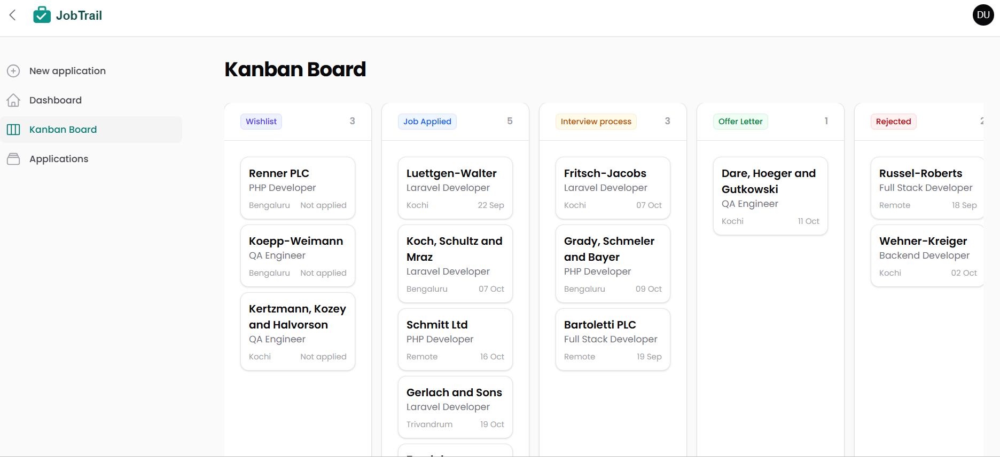
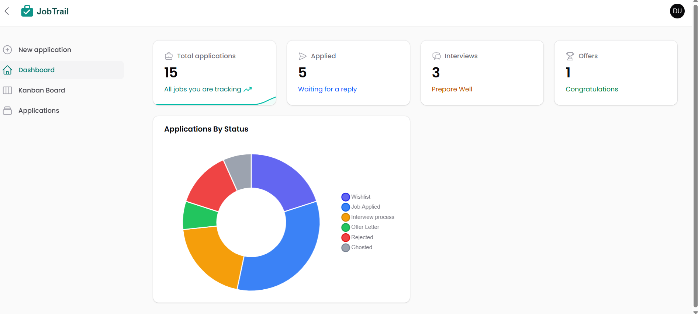
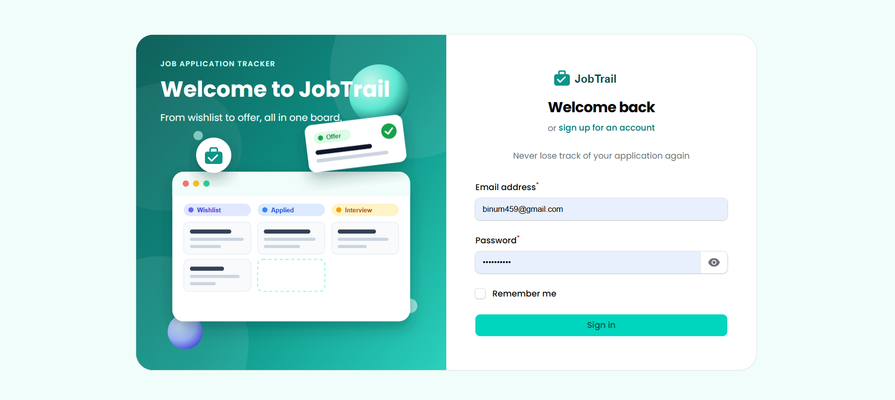
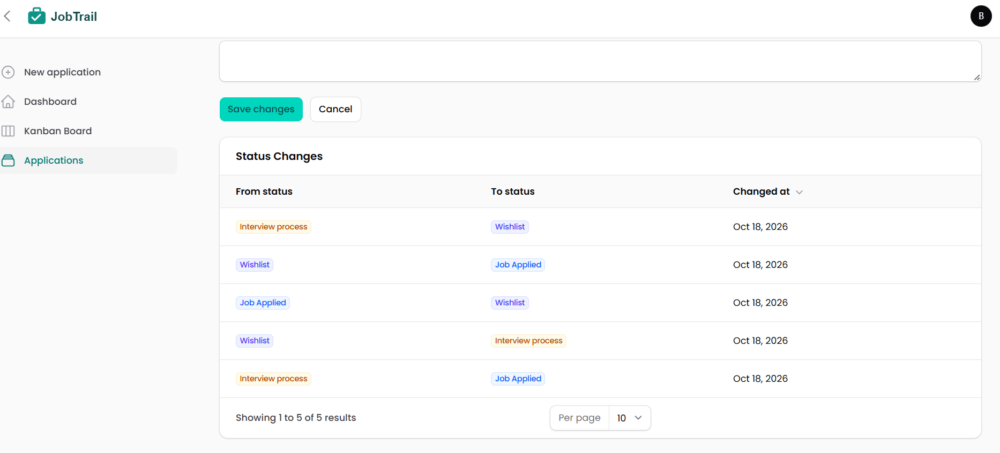
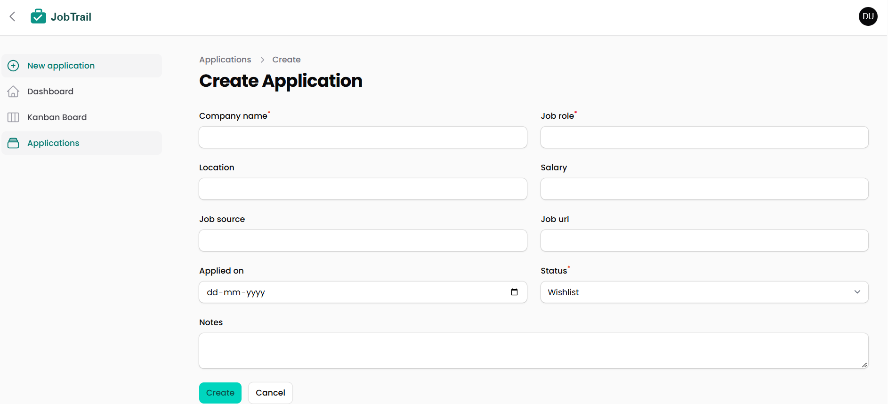

# JobTrail

A job application tracker with a drag-and-drop Kanban board. Move each application through Wishlist, Applied, Interview and Offer, and see your progress on a dashboard.



## Demo Login
Demo login: `demo@jobtrail.test` / `password`

## Features

- **Kanban board**: drag and drop your applications between stages
- **Status history**: records every status change, from Wishlist to Offer, with the date
- **Dashboard**: shows how many applications are in each status, with a doughnut chart
- **Security**: each user can only see their own applications
- **Sign up and login** pages

## Screenshots

| Dashboard | Login |
|---|---|
|  |  |

| Status timeline | New application |
|---|---|
|  |  |

## Tech stack

- Laravel 13 (PHP 8.5)
- Filament 5 and Livewire 4
- MySQL
- Tailwind CSS 4 (custom Filament theme), Vite
- Pest (testing)

## Technical highlights

- **Kanban drag and drop**: built with Livewire 4's `wire:sort`. The server only loads the user's own card, checks the new status with the enum, and saves the status and card order in a database transaction.
- **Automatic status history**: an Eloquent observer listens for model events. Every time an application's status changes, from the form or the Kanban board, it records the old status, the new status and the date.
- **Security in two layers**: each user only sees their own applications. The Filament resource query is scoped to the logged-in user, and an `ApplicationPolicy` blocks viewing, editing or deleting anyone else's records, so opening another user's application by URL returns a 404.
- **Status enum**: the 6 stages are a PHP enum with labels and colours. Invalid statuses can never be saved, and the same enum drives the badges, filters, Kanban columns and charts.

## Run it locally

```bash
git clone https://github.com/binum459/jobtrail.git
cd jobtrail
composer install
npm install
cp .env.example .env
php artisan key:generate
# set your database details in .env, then:
php artisan migrate --seed
npm run build
php artisan serve
```

Open http://127.0.0.1:8000/app and log in with the demo account.

## Tests

```bash
vendor/bin/pest
```

## About

Built by Binu as a portfolio project.
